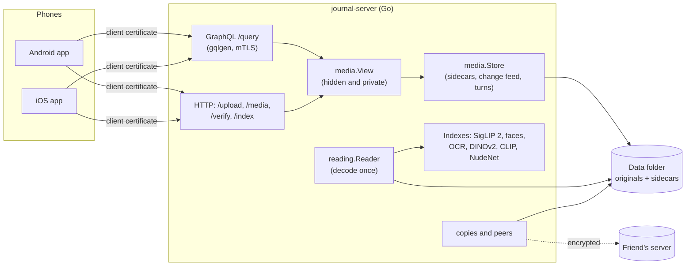

# Journal server

A self-hosted server for a private photo journal. It backs up every photo, video and sound recording from your
phones into a plain folder of files that you own. Every device gets a client certificate, and the server answers
over mutual TLS. Search, face recognition, text in photos, duplicates and backups to other disks or a friend's server
all run on your own machine, with no cloud service involved.

It is written in Go, with no cgo, and runs on Windows, macOS and Linux. The Android and iOS apps are in
[journal-client-kmp](https://github.com/chencohensolutions/journal-client-kmp).

## Highlights

- **Your files are the truth.** There's no database. Originals are kept byte for byte under
  `media/<year>/<year-month>/`, each with a JSON sidecar beside it (facts, privacy, model output). The in-memory
  index and every cache can be rebuilt from the folder, so the folder alone is a complete, portable archive.
- **mTLS for everything.** A phone enrolls once, with a one-time code or a QR code. It creates its key in secure
  hardware (Android StrongBox/Keystore, iOS Secure Enclave) and the server signs a certificate for it. Access is
  denied by default: without a certificate, a device can reach only the two enrollment fields. Devices can be
  listed, revoked, and renewed in their last 30 days.
- **Resumable uploads and exact-size previews.** `PUT /upload/{sha256}` resumes where it stopped, and the sha256 is
  the file's id, which also deduplicates. `GET /media/{sha256}` supports HTTP Range for video streaming. Previews come
  from libvips at the exact size a tile asks for, and video posters come from ffmpeg.
- **Indexes on your own machine, in one pass.** A single reader decodes each original once and feeds every index
  exactly the picture its model expects, all on ONNX Runtime:
  - **Text search** with SigLIP 2 (`searchMedia`).
  - **Faces**: YuNet detects them and SFace recognizes them. The server groups alike faces, and the user names people.
  - **OCR** for Hebrew and English text in photos.
  - **Similar photos and duplicates** with DINOv2.
  - **Aesthetic scores** with LAION on CLIP ViT-L/14.
  - A **nudity scan** with NudeNet.
- **Privacy built into the server.** Users can mark files private and hide whole collections: WhatsApp, chosen
  apps' screenshots, calls and recordings, or what the nudity scan flags. The server does the hiding itself, through
  a per-device `media.View`, so a hidden file is missing from the change feed, previews, search and usage on that
  device.
- **Backups without a cloud.**
  - **Copies** go to other folders or disks, daily or as files arrive.
  - **Peers**: a friend's server can keep a copy. Two servers can **swap**, each keeping the other's copy.
  - Copies on peers can be **encrypted** with [age](https://age-encryption.org), and `restore` brings a data
    folder back from a peer or a folder.
  - Peers find each other through the BitTorrent DHT, so neither side needs a fixed IP or host name.
- **Phones can search offline.** The server streams its indexes to phones (`localIndexes`, `/index/{name}`), so
  the app can keep them and search without a connection.
- **JPEG XL, losslessly.** JPEG photos are kept as JPEG XL. Each one is checked to rebuild the original JPEG byte
  for byte before the JPEG is replaced. Phone photos come out about 20% smaller, with nothing lost.
- **Imports from anywhere.** `scripts/import` brings in photos from folders, Google Drive or OneDrive
  (through rclone). It reads dates, GPS and cameras, finds near-duplicates with dHash, and has a
  review page in the browser.
- **Safe with several processes.** The server, imports and maintenance scripts can share a data folder. Each writer
  takes a file lock for the milliseconds a write takes and appends to a journal, so the others catch up.
- **Windows installer.** A 10 MB Inno Setup installer downloads ONNX Runtime, the models, libvips and ffmpeg,
  checking each against a published sha256. It then sets up the config, the certificates, a Windows service and the
  firewall rule.

## Architecture



- **Two GraphQL schemas, one binary.** The public schema (`graph/schema/*.graphql`, one file per area) serves
  phones on `:56398` over mTLS. The admin schema (`graph/admin/`) listens on loopback only, with a bearer token the
  server rewrites on every start. Admin commands such as `enroll-code`, `devices`, `revoke` and `copy` are GraphQL
  clients of the running server.
- **`media` owns the on-disk format.** It holds the sidecar format and the store's start-up scan, upload,
  change feed, file naming that is safe on every OS, and atomic writes. A device reaches files only through a
  `media.View`.
- **Native libraries without cgo.** ONNX Runtime, libvips and libjxl are loaded at run time through
  [purego](https://github.com/ebitengine/purego), and ffmpeg runs as a separate program. Without them the server
  still runs, and the affected features answer 503 or are listed as off in `serverInfo`.
- **Errors a device acts on are typed.** Results a phone must act on are GraphQL unions with a reason, and other
  errors carry `extensions.code`. `serverInfo` tells the apps what this server can do, so apps don't have to learn it
  from errors.

## Getting started

Requirements:
- Go 1.26 or newer. gqlgen runs as a `go tool` of the module.
- Optional: libvips and ffmpeg (`brew install vips ffmpeg`) for previews and posters.
- Optional: ONNX Runtime and the models, for the indexes: `go run ./scripts/bundle-onnx` downloads them into
  `onnxruntime/` and `models/`.

```bash
git clone https://github.com/chencohensolutions/journal-server-go.git
cd journal-server-go

# Make a server folder with a config, a CA and a server certificate
go run . setup --dir ../my-journal --user alice --data-folder ../my-journal/alice --new-ca --address localhost

# Or by hand: copy config.example.json to config.json, then
scripts/generate-ca.sh
SERVER_NAMES="myhome.example.org" scripts/generate-server-cert.sh   # names and IPs devices will use

go run .                        # serves https://0.0.0.0:56398
go run . enroll-code alice      # a one-time code and a QR code for the app, valid 10 minutes
```

In the app, choose **Register this device** and scan the code. Other admin commands:

```bash
go run . devices [user]                    # enrolled devices
go run . revoke <serial>                   # lock a device out
go run . private <serial> withhold|allow   # keep the user's private files from one device
go run . copy [user] | copy report [user]  # run the copies now; what each copy lacks
go run . peer invite --name <n> --quota 2TB | peer add <name> <url> <code> [--trusted]
go run . restore <user> (--from <peer> | --from-folder <dir>) --to <empty dir>
go run . index [--user name] [--progress]  # read new files for the indexes once and exit
```

On Windows, `scripts/release.sh` builds the installer (see [docs/install.md](docs/install.md)).

## Development

```bash
go test ./...                    # ~10 s; preview, poster, search and face tests skip without libvips, ffmpeg or models
go vet ./...
go tool gqlgen generate          # after editing graph/schema/*.graphql
go tool gqlgen generate --config gqlgen.admin.yml
```

The tests use real temporary data folders rather than mocks. `newTestEnv` starts a full mTLS server with a generated
CA and an enrolled device. Each `serve_*_test.go` covers one area end to end (media, search, faces, private, hidden,
copies, peers, discovery), and the `media` tests drive a `Store` directly.

After changing the public schema, run `./gradlew :sharedLogic:syncServerSchema` in the client repo so the apps get
the new copy.

## Project layout

```
main.go, serve.go, middleware.go   start-up, routing table (newMux), identify / gzip / deadlines
library.go                         opens each user's data folder; finds libvips, ffmpeg, ONNX Runtime
admin.go, admincli.go              the loopback admin API and the commands that call it
auth/  enroll/  certs/             config, request identity and @public, enrollment and issuing, CA and certificates
media/                             data folder: store, sidecars, upload, change feed, previews, JPEG XL, turns
graph/                             public schema, resolvers, gqlgen output; graph/admin/ for the admin API
reading/                           the reader that decodes each original once for every index
search/ faces/ ocr/ similar/       the indexes on ONNX Runtime (package onnx, through purego)
aesthetic/ nudity/
localindex/                        index streams for phones, filtered by each device's view
copies/ peers/ discovery/          copies, the peer API, BitTorrent DHT discovery
bundle/ installer/                 downloads for the installer, Inno Setup script
scripts/                           import, jxl, scan-nudity, read-cameras, fix-sources, bundle-onnx, bundle-vips, certs
docs/                              the design of each area (below)
```

## Documentation

| | |
|---|---|
| [authentication.md](docs/authentication.md) | enrollment, certificates, the device registry, the admin API, revocation, withholding private files |
| [media.md](docs/media.md) | the data folder and sidecar format, uploads, previews, sources, the change feed, hidden collections, sound recordings, JPEG XL, imports, turns |
| [indexes.md](docs/indexes.md) | the reader and every index: models, costs, and how to add one |
| [search.md](docs/search.md) | text search with SigLIP 2, and the indexes a phone keeps to search without the server |
| [faces.md](docs/faces.md) | face detection and recognition, groups of alike faces, naming people |
| [copies.md](docs/copies.md) | copies in other folders and disks |
| [peers.md](docs/peers.md) | copies on a friend's server, swaps, encryption, restore |
| [install.md](docs/install.md) | the Windows installer, `setup`, versions |

The product design and the decisions behind it are in the client repo's
[docs/design.md](https://github.com/chencohensolutions/journal-client-kmp/blob/main/docs/design.md).

## How it was built

A single developer built this project, with [Claude Code](https://claude.com/claude-code) as a pair programmer.
`CLAUDE.md` holds the conventions both follow, and the docs above are kept in step with the code.
